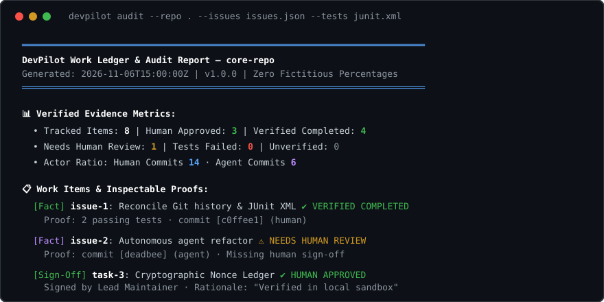

<p align="center">
  
</p>

# DevPilot

<p align="center">
  <strong>Registro lavori deterministico &amp; audit trail ispezionabile per progetti con sviluppatori e agenti AI.</strong><br>
  Riconcilia la cronologia Git, le issue esportate e l'esito dei test in evidenze oggettive senza percentuali arbitrarie.
</p>

<p align="center">
  <a href="https://github.com/MRJonam91/DevPilot/actions/workflows/ci.yml"></a>
  <a href="LICENSE"></a>
  
  
  <a href="#-donazioni--sponsor"></a>
</p>

---

**Italiano** | [English](README.md)

## 💡 Il Problema

Quando si collabora con agenti AI autonomi per la scrittura di codice (Claude, Cursor, Copilot, ChatGPT, ecc.), la visibilità sullo stato del lavoro si disperde rapidamente:
- **Avanzamento allucinato**: gli agenti inventano percentuali di completamento arbitrarie (*"Task completato all'85%"*) senza riscontro nel codice o nei test.
- **Verità frammentata**: commit Git, output dei test runner e issue tracker vivono in silos separati e disallineati.
- **Commit invisibili degli agenti**: codice generato da agenti entra nel branch principale senza una revisione o responsabilità umana esplicita.

**DevPilot** risolve questa dispersione creando un'unica fonte di verità locale, verificabile e priva di fuffa:
1. **Fatti prima delle stime**: contano solo i commit reali osservati, lo stato verificabile delle issue e l'esito concreto delle asserzioni dei test.
2. **Revisione umana obbligatoria**: i commit prodotti da agenti AI restano nello stato `NEEDS_HUMAN_REVIEW` finché uno sviluppatore umano non li approva esplicitamente.
3. **Prove cliccabili e ispezionabili**: ogni stato riporta prove oggettive sia nel report da terminale sia nella dashboard HTML locale autonoma.

---

## 🚀 Avvio rapido​‌​​‌‌​‌​‌​‌​​‌​​‌​​‌​‌​​​‌‌‌​​‌​​‌‌​​​‌​​‌​‌‌​‌​‌‌​​‌​​​‌‌‌​​​​​​‌​‌‌​‌​‌‌​​‌​​​​‌‌​‌​​​‌‌​​‌​‌​​‌‌​​​‌​‌‌​​‌‌​​​‌‌‌​​​

Esegui direttamente con `npx` (nessuna installazione necessaria, richiede Node.js ≥ 22):

```bash
# Esegui l'audit del repository corrente e stampa il report nel terminale
npx devpilot report

# Audit con issue esportate e risultati test JUnit
npx devpilot report --issues issues.json --tests junit.xml

# Esporta il report HTML interattivo e autonomo per il browser
npx devpilot report --format html --output devpilot-report.html
```

---

## 🛠️ Funzionalità Chiave

- **Regola Zero-Bullshit**: nessuna stima fittizia o percentuale inventata. Ogni attività è classificata unicamente in base a prove concrete: `VERIFIED_COMPLETED`, `IN_PROGRESS`, `TESTS_FAILED`, `NEEDS_HUMAN_REVIEW` o `HUMAN_APPROVED`.
- **Parser Evidenze Git**: analizza la cronologia locale dei commit, classifica l'identità dell'autore (`human` vs `agent`), estrae i trailer `Co-authored-by` e mappa i riferimenti alle issue (`#12`).
- **Riconciliazione Issue Tracker**: importa esportazioni di issue (JSON di GitHub CLI o elenchi Markdown) e le correla all'attività reale del repository.
- **Adattatore Risultati Test**: legge report XML JUnit e file JSON dei runner di test standard. Rileva asserzioni fallite, test passati e suite saltate.
- **Firma e Approvazione Umana**: permette agli sviluppatori di verificare e approvare le attività degli agenti salvando firme tracciabili in `.devpilot/ledger.json`.
- **Zero Dipendenze Esterne a Runtime**: puro TypeScript eseguito sul runtime nativo di Node.js.
- **Core Compatto e Auditabile**: il motore principale (`src/core/`) resta rigorosamente sotto le 1.500 righe di codice.

---

## 📋 Tassonomia delle Evidenze

| Livello | Classificazione | Significato |
|---|---|---|
| 🟢 **Fatto Osservato** | `observed_fact` | Dati empirici e verificabili (SHA del commit, asserzioni dei test, stato issue). |
| 🟡 **Stima Euristica** | `estimate` | Correlazione dedotta per somiglianza (titolo, branch name). |
| 🔵 **Approvazione Umana** | `human_approval` | Firma esplicita di uno sviluppatore con identità, data e motivazione registrata. |

---

## 💻 Comandi CLI

```bash
# Inizializza il ledger locale
devpilot init

# Ispeziona il repository e genera il report a terminale
devpilot report

# Sintesi compatta dello stato con strict check per la CI
devpilot status --strict

# Ispeziona nel dettaglio i commit, le modifiche e i test per un task specifico
devpilot diff issue-1

# Esporta il pacchetto di audit completo (HTML, Markdown e JSON) su disco
devpilot export --output ./audit-dist/

# Approva il lavoro svolto da un agente indicando la motivazione
devpilot approve task-1 --by "Manoj" --note "Verificato passaggio della suite in sandbox isolata"

# Rifiuta o blocca un'attività non verificata
devpilot reject issue-42 --by "Alice" --note "Rilevata regressione di memoria nel benchmark"

# Verifica l'integrità del registro locale con controllo anti-manomissione (SHA-256)
devpilot verify
```

---

## 💖 Donazioni & Sponsor

DevPilot è un progetto indipendente, completamente gratuito e open source rilasciato con licenza Apache-2.0. Se DevPilot ti aiuta a portare trasparenza e rigore nei tuoi flussi di lavoro con assistenti AI, considera di supportare lo sviluppo:

- **GitHub Sponsors**: [github.com/sponsors/MRJonam91](https://github.com/sponsors/MRJonam91)
- **Ko-fi**: [ko-fi.com/mrjonam](https://ko-fi.com/mrjonam)
- **Buy Me a Coffee**: [buymeacoffee.com/mrjonam](https://buymeacoffee.com/mrjonam)
- **PayPal**: [paypal.me/manorollo](https://paypal.me/manorollo)

---

## 📜 Licenza

Rilasciato sotto licenza **Apache License, Version 2.0** ([LICENSE](LICENSE)).  
Le ridistribuzioni e i lavori derivati devono conservare il file [NOTICE](NOTICE) e l'attribuzione visibile.
