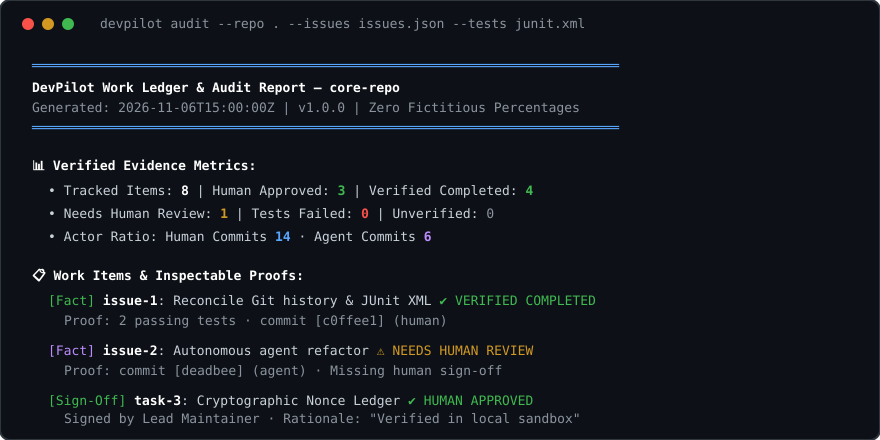

<p align="center">
  
</p>

# DevPilot

<p align="center">
  <strong>Deterministic work ledger &amp; inspectable audit trail for human and AI agent projects.</strong><br>
  Reconciles Git commit history, exported issues, and test runs into factual evidence without fictitious percentages.
</p>

<p align="center">
  <a href="https://github.com/MRJonam91/DevPilot/actions/workflows/ci.yml"></a>
  <a href="LICENSE"></a>
  
  
  <a href="#-donations--sponsor"></a>
</p>

---

[Italiano](README.it.md) | **English**

## 💡 The Problem

When developers collaborate with autonomous AI coding agents (Claude, Cursor, Copilot, ChatGPT, etc.), work status quickly fractures:
- **Hallucinated Progress**: Agents invent completion percentages (*"Task is 85% complete"*) that bear no relation to real code or passing tests.
- **Scattered Truth**: Git commits, test runner outputs, and tracker issues live in disconnected silos.
- **Invisible Agent Commits**: Unreviewed agent code slips into main without explicit human accountability.

**DevPilot** restores trust with a single, verifiable, local-first source of truth:
1. **Facts over Estimates**: Only observed commits, verifiable issue states, and actual test runner assertions count.
2. **Mandatory Human Sign-off**: Code originating from AI agents remains in `NEEDS_HUMAN_REVIEW` until signed off with a cryptographic nonce.
3. **Inspectable Proofs**: Clickable evidence trails for every item in both terminal CLI and standalone HTML dashboards.

---

## 🚀 Quick start​‌​​‌‌​‌​‌​‌​​‌​​‌​​‌​‌​​​‌‌‌​​‌​​‌‌​​​‌​​‌​‌‌​‌​‌‌​​‌​​​‌‌‌​​​​​​‌​‌‌​‌​‌‌​​‌​​​​‌‌​‌​​​‌‌​​‌​‌​​‌‌​​​‌​‌‌​​‌‌​​​‌‌‌​​​

Run directly with `npx` (zero install needed, requires Node.js ≥ 22):

```bash
# Audit current repository and generate local terminal report
npx devpilot report

# Audit with exported issues and JUnit test results
npx devpilot report --issues issues.json --tests junit.xml

# Export standalone interactive HTML report
npx devpilot report --format html --output devpilot-report.html
```

---

## 🛠️ Key Capabilities

- **Zero-Bullshit Rule**: No arbitrary completion metrics. Every task is classified by concrete proof: `VERIFIED_COMPLETED`, `IN_PROGRESS`, `TESTS_FAILED`, `NEEDS_HUMAN_REVIEW`, or `HUMAN_APPROVED`.
- **Git Commit Evidence Parser**: Analyzes local commit history, identifies author identity (`human` vs `agent`), tracks `Co-authored-by` trailers, and maps commit refs (`#12`).
- **Issue Tracker Reconciler**: Ingests issue dumps (GitHub CLI JSON or Markdown checklist) and correlates them with actual repository activity.
- **Test Runner Adapter**: Parses JUnit XML and standard test runner JSON logs. Detects failing assertions and skipped suites.
- **Cryptographic Human Sign-off**: Developers review and sign off tasks with verifiable audit records in `.devpilot/ledger.json`.
- **Zero Runtime Dependencies**: Pure TypeScript running natively on Node.js standard library.
- **Compact Auditable Core**: Core engine (`src/core/`) stays strictly under 1,500 lines of code.

---

## 📋 Evidence Classification

| Level | Classification | Meaning |
|---|---|---|
| 🟢 **Observed Fact** | `observed_fact` | Cryptographically or structurally verified data (Git SHA, test run assertions, issue state). |
| 🟡 **Estimate** | `estimate` | Inferred correlation (heuristic subject matching, branch naming). |
| 🔵 **Human Approval** | `human_approval` | Explicit human developer sign-off with recorded identity and rationale. |

---

## 💻 CLI Commands

```bash
# Initialize local ledger
devpilot init

# Inspect repository and print terminal report
devpilot report

# Quick status digest for CI and terminal prompts
devpilot status --strict

# Inspect evidence trail and commits for a specific task
devpilot diff issue-1

# Export full audit bundle (HTML, Markdown, and JSON) to disk
devpilot export --output ./audit-dist/

# Approve agent-authored work with audit rationale
devpilot approve task-1 --by "Alice" --note "Verified test suite passes in isolated sandbox"

# Reject or block an unverified claim
devpilot reject issue-42 --by "Bob" --note "Memory regression detected during benchmark"

# Verify local ledger integrity with cryptographic tamper-evidence
devpilot verify
```

---

## 💖 Donations & Sponsor

DevPilot is an independent, 100% free and open-source project under the Apache-2.0 license. If DevPilot helps you bring transparency and rigor to your AI-assisted engineering workflows, please consider supporting ongoing maintenance:

- **GitHub Sponsors**: [github.com/sponsors/MRJonam91](https://github.com/sponsors/MRJonam91)
- **Ko-fi**: [ko-fi.com/mrjonam](https://ko-fi.com/mrjonam)
- **Buy Me a Coffee**: [buymeacoffee.com/mrjonam](https://buymeacoffee.com/mrjonam)
- **PayPal**: [paypal.me/manorollo](https://paypal.me/manorollo)

---

## 📜 License

Licensed under the **Apache License, Version 2.0** ([LICENSE](LICENSE)).  
Redistributions and derivative works must retain the [NOTICE](NOTICE) file and visible attribution.
